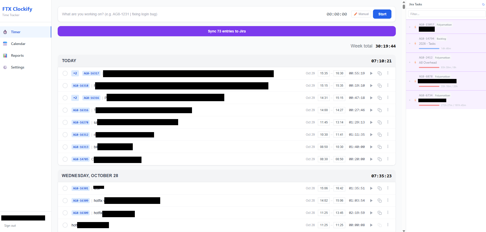
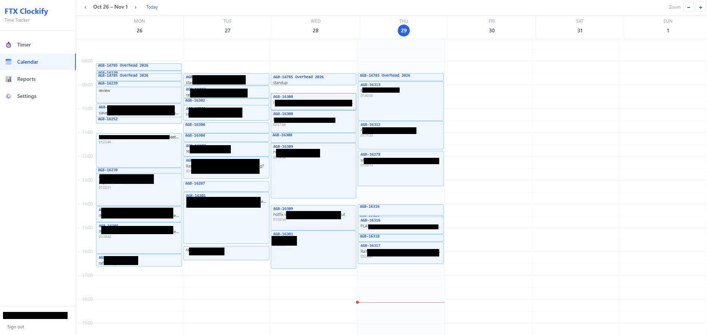
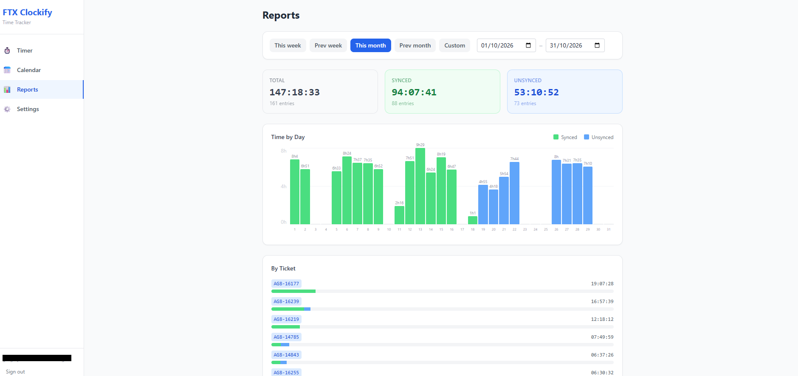
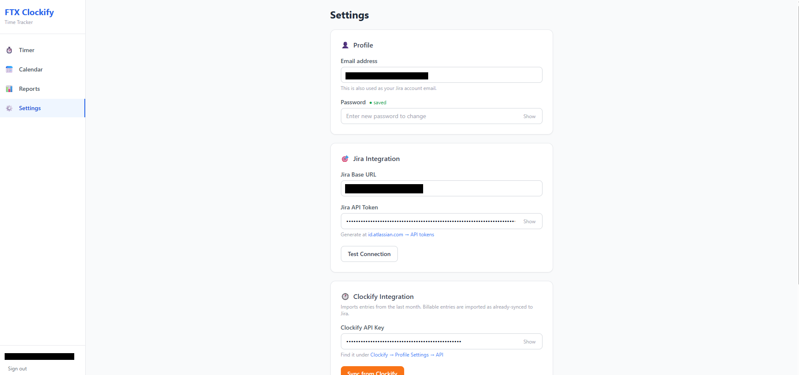

# clocky-at-home

A self-hosted time tracker that logs work locally, imports your entries from [Clockify](https://clockify.me) and pushes them as worklogs to Jira.

- Start/stop a running timer or add manual time entries
- Calendar, dashboard and reports views
- Browse Jira issues and create subtasks
- Import time entries from Clockify (one-way: Clockify → clocky; nothing is written back to Clockify)
- Sync entries to Jira as issue worklogs, and mark them as synced
- Per-user accounts and settings (API keys are stored in the local SQLite database)

## Screenshots






## Stack

- **Client:** React, TypeScript, Vite, Tailwind CSS (`client/`)
- **Server:** Node.js, Express, TypeScript, SQLite via `better-sqlite3` (`server/`)

## Development

```bash
npm run install:all
cp .env.example .env
npm run dev
```

The client runs on http://localhost:3000 and the API on http://localhost:3001.

## Deployment

```bash
./package.sh                      # creates ftx-clockify.zip
# on the server:
unzip ftx-clockify.zip -d ftx-clockify && cd ftx-clockify
cp .env.example .env              # set PORT, CORS_ORIGIN, NODE_ENV=production
./deploy.sh                       # install dependencies and build
./start.sh                        # run in a tmux session
```

`start.sh` requires `tmux`, and `package.sh` requires `zip`.

## Configuration

See [`.env.example`](.env.example):

| Variable | Description |
|---|---|
| `PORT` | Server port (default `3001`) |
| `CORS_ORIGIN` | Allowed frontend origin |
| `NODE_ENV` | Set to `production` when deploying |
| `DATA_DIR` | Optional directory for `clockify.db` (defaults to `data/`) |

Clockify and Jira credentials are entered in the app's Settings page, not in `.env`.
